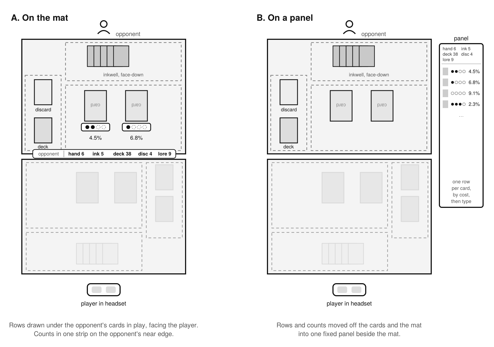

# InkZero AR

InkZero AR is a passive overlay on a passthrough headset. It shows a Disney Lorcana player where each copy of the opponent's cards is, and the chance of each card being drawn next.

Lorcana is a two-player trading card game with 60-card decks and hidden hands. A lot of what decides a game is information the player has already seen and has to hold in their head: which cards the opponent inked, discarded or revealed. InkZero AR keeps that information in view, drawn on the mat under the cards or in a panel beside it, while the player plays the game the way it is always played.



It is designed as a free helper for practice and casual play. It is not for tournaments. Card images and card data come from a public Lorcana card API, under Ravensburger's community guidelines.

## Course project

InkZero AR is a course project for HCC 552, AR/VR Design and Research, at Grand Valley State University, Fall 2026. The proposal is the place to start: [PDF](ar/docs/proposal/proposal.pdf), [Markdown](ar/docs/proposal/proposal.md).

## Layout

```
ar/docs/proposal/    the proposal, its figures, and the slides once presented
ar/docs/uml/         use case, class, sequence and package diagrams
ar/docs/naming.md    every package, class, field and method name, and the naming rules
ar/scenes/           scene files, one per scene
ar/tools/            small scripts that are not the app
ar/unity/            the Unity project, from Sprint 1
```

## Author and license

Arthur Bowman, M.S. in Artificial Intelligence, Grand Valley State University.

[MIT License](LICENSE) for the code and documents. Card data and images are not covered by it.

InkZero AR is unofficial Fan Content permitted under Ravensburger's community guidelines. Not approved or endorsed by Disney or Ravensburger. Disney Lorcana and all related characters and elements are the property of Disney and Ravensburger.

## AI use

I used Claude, an AI assistant, as a tool to help draft and edit the documents in this repo. The design and the judgment behind it are mine.
